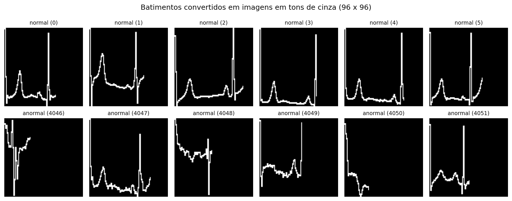
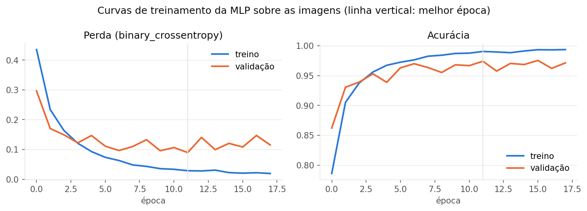
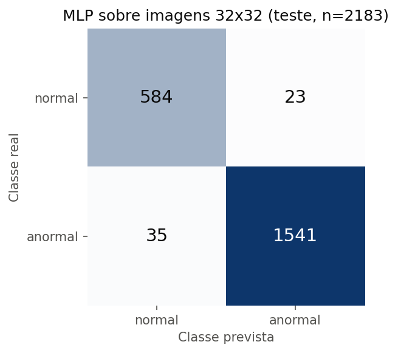
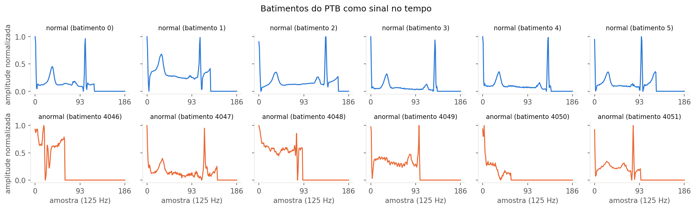

# FIAP - Faculdade de Informática e Administração Paulista

<p align="center">
<a href= "https://www.fiap.com.br/"></a>
</p>

<br>

# CardioIA: diagnóstico visual em cardiologia com rede neural MLP em Keras (Fase 2, Ir Além 2)

## Grupo 69

## 👨‍🎓 Integrantes: 
- <a href="https://www.linkedin.com/in/silvio-guerreiro">Silvio Prestes Guerreiro Junior, RM567958</a>

## 👩‍🏫 Professores:
### Tutor(a) 
- <a href="https://www.linkedin.com/in/leonardoorabona">Leonardo Ruiz Orabona</a>
### Coordenador(a)
- <a href="https://www.linkedin.com/company/inova-fusca">André Godoi Chiovato</a>

## 🎥 Vídeo de demonstração

**Link (YouTube, não listado, até 4 minutos):** [A INSERIR APÓS A PUBLICAÇÃO]

## 📜 Descrição

Classificador binário de batimentos de eletrocardiograma (normal vs. anormal) construído com uma rede neural do tipo MLP (Perceptron Multicamadas) em Keras, a partir de imagens em tons de cinza dos batimentos. O notebook [`src/notebooks/cardioia_ecg_mlp.ipynb`](src/notebooks/cardioia_ecg_mlp.ipynb) percorre o caminho completo: carga do dataset público, conversão dos batimentos em imagens, pré-processamento (tons de cinza, redimensionamento, normalização, achatamento), divisão em treino, validação e teste, construção e treinamento da MLP, avaliação com acurácia, AUC, matriz de confusão e relatório de classificação, comparação com a mesma rede sobre o sinal numérico original e análise de limiares, limitações e ética.

Este repositório é o Ir Além 2 da Fase 2 do projeto CardioIA. O repositório principal da fase (extração de sintomas e classificador de risco textual) é [FIAP_2TIAOR_2026_Ano2_Fase2](https://github.com/silvioguerreiro/FIAP_2TIAOR_2026_Ano2_Fase2); o Ir Além 1 (portal em React) é [FIAP_2TIAOR_2026_Ano2_Fase2_Ir_Alem_1_Grupo69_cardioia-portal](https://github.com/silvioguerreiro/FIAP_2TIAOR_2026_Ano2_Fase2_Ir_Alem_1_Grupo69_cardioia-portal).

### Ponto de atenção sobre o dataset

O dataset recomendado pelo enunciado (Kaggle, [`shayanfazeli/heartbeat`](https://www.kaggle.com/datasets/shayanfazeli/heartbeat)) distribui os batimentos como séries numéricas de 187 amostras em arquivos CSV, e não como arquivos de imagem. Para atender literalmente à etapa de pré-processamento de imagens (redimensionar e converter para tons de cinza), este trabalho adota o seguinte caminho:

1. Cada batimento do subconjunto PTB (binário: normal vs. anormal) é desenhado como o traçado de um gráfico de linha em uma imagem em tons de cinza de 96 x 96 pixels, com fundo preto e traço branco; vinte exemplos são gravados em PNG em [`assets/exemplos_imagens/`](assets/exemplos_imagens/).
2. As imagens passam pelo pré-processamento pedido: conversão para um canal em tons de cinza (modo `L` do Pillow), redimensionamento para 32 x 32 pixels, normalização para o intervalo 0 a 1 e achatamento em um vetor de 1.024 valores.
3. A MLP recebe esse vetor. Ao final, a mesma arquitetura é treinada sobre o sinal numérico original, para medir o efeito da conversão.

A decisão está documentada no notebook (cabeçalho e seção 4). O notebook é autossuficiente: as funções de obtenção do dataset, de conversão do sinal em imagem e de pré-processamento estão definidas nas suas próprias células, com docstrings e comentários. O arquivo [`src/preparar_imagens.py`](src/preparar_imagens.py) reúne as mesmas funções em um utilitário de linha de comando, para gerar os exemplos de imagens sem abrir o Jupyter.

### Requisitos do enunciado e onde estão atendidos

| Requisito | Implementação | Onde |
|---|---|---|
| Dataset público de ECG com classificação binária (normal vs. anormal) | Subconjunto PTB do dataset recomendado: 4.046 batimentos normais e 10.506 anormais (14.552 no total), com integridade conferida por SHA-256 | Notebook, seção 2 (`localizar_dataset`, `carregar_ptb`); `data/LEIAME.md` |
| Pré-processar as imagens e convertê-las para formato compatível com redes simples (redimensionar, tons de cinza) | Imagens 96 x 96 em tons de cinza geradas a partir dos batimentos; conversão para modo `L`, redimensionamento bilinear para 32 x 32, normalização em [0, 1] e achatamento em vetor de 1.024 posições; demonstração a partir dos arquivos PNG em disco | Notebook, seções 4 e 5; `batimentos_para_imagens`, `imagem_para_vetor`, `carregar_pasta_de_imagens` |
| Criar uma rede neural MLP com Keras | `keras.Sequential` com entrada de 1.024 valores, camadas densas de 256 e 128 neurônios (ReLU), `Dropout` de 0,3 após cada uma e saída `sigmoid`; `binary_crossentropy`, Adam, métricas de acurácia e AUC; 295.425 parâmetros | Notebook, seção 7 (`construir_mlp`) |
| Treinar e testar o modelo | Divisão estratificada 70/15/15 (treino, validação, teste), pesos de classe, `EarlyStopping` com restauração dos melhores pesos; teste usado uma única vez | Notebook, seções 6, 8 e 9 |
| Avaliar a acurácia do classificador | Acurácia, AUC, sensibilidade, especificidade, matriz de confusão, `classification_report`, comparação com a linha de base e com a MLP sobre o sinal bruto, tabela de limiares | Notebook, seções 9 a 11 |
| Notebook comentado e funcional | 28 células (14 de texto, 14 de código), todas as funções do pipeline definidas no próprio notebook, comentários em todas as células de código, executado de ponta a ponta sem erros, com as saídas gravadas | `src/notebooks/cardioia_ecg_mlp.ipynb` |
| Repositório com notebook, exemplos de imagens e README explicativo | Este repositório; imagens em `assets/exemplos_imagens/` e figuras em `assets/` | estrutura abaixo |

### Critérios de avaliação

| Critério | Como foi atendido |
|---|---|
| Pré-processamento correto das imagens | Conversão explícita para tons de cinza, redimensionamento para 32 x 32, normalização 0 a 1 e achatamento, em função única e testada (`imagem_para_vetor`), aplicada tanto às imagens em memória quanto aos PNGs gravados em disco; imagens antes e depois exibidas no notebook |
| Implementação funcional da rede MLP com Keras | Modelo sequencial em Keras 3 (TensorFlow 2.20), com `summary()` exibido, compilado com perda e métricas adequadas à classificação binária, salvo em `src/models/mlp_ecg_imagens.keras` |
| Treinamento e avaliação com resultados apresentados | Curvas de treino e validação, acurácia de 0,9734 e AUC de 0,9948 no teste, matriz de confusão, relatório por classe, comparação com o sinal bruto e com a linha de base, efeito do limiar de decisão |
| Organização e clareza do código no notebook | Notebook autossuficiente (todas as funções do pipeline definidas nas células, sem importar módulos do repositório), seções numeradas com explicação antes de cada célula, funções com docstrings e comentários, sementes fixas e operações determinísticas, caminhos relativos à raiz do repositório, execução no Google Colab documentada |

## 📊 Resultados

Conjunto de teste com 2.183 batimentos (607 normais e 1.576 anormais), semente 42, operações determinísticas no TensorFlow. Os números abaixo foram copiados das saídas do notebook.

| Medida | MLP sobre imagens 32 x 32 | MLP sobre o sinal original (187 valores) | Linha de base (sempre anormal) |
|---|---|---|---|
| Acurácia | 0,9734 | 0,9482 | 0,7219 |
| AUC | 0,9948 | 0,9830 | 0,5000 |
| Sensibilidade da classe anormal | 0,9778 | 0,9467 | 1,0000 |
| Especificidade da classe normal | 0,9621 | 0,9522 | 0,0000 |
| Parâmetros treináveis | 295.425 | 81.153 | 0 |

Matriz de confusão da MLP sobre imagens (limiar 0,5): 584 verdadeiros negativos, 23 falsos positivos, 35 falsos negativos e 1.541 verdadeiros positivos. O treinamento parou na época 18 e restaurou os pesos da época 12 (menor perda de validação, 0,0897), em cerca de 14 segundos em CPU.

| Limiar | Acurácia | Sensibilidade anormal | Especificidade normal | Falsos negativos | Falsos positivos |
|---|---|---|---|---|---|
| 0,3 | 0,9734 | 0,9848 | 0,9440 | 24 | 34 |
| 0,5 | 0,9734 | 0,9778 | 0,9621 | 35 | 23 |
| 0,7 | 0,9702 | 0,9670 | 0,9786 | 52 | 13 |

| Batimentos convertidos em imagens | Curvas de treinamento |
|---|---|
|  |  |

| Matriz de confusão (teste) | Batimentos como sinal no tempo |
|---|---|
|  |  |

Leitura dos resultados: a rede aprendeu o traçado, e não a proporção das classes (a acurácia fica 25 pontos acima da linha de base); a conversão em imagem não destruiu a informação clínica do batimento, e nesta configuração a entrada em imagem superou o sinal bruto, o que é uma observação deste experimento específico e não uma regra geral. Em triagem, o falso negativo é o erro mais grave; a tabela de limiares mostra que um limiar abaixo de 0,5 reduz os falsos negativos ao custo de mais falsos positivos, e essa escolha pertence à equipe clínica.

## 📁 Estrutura de pastas

Dentre os arquivos e pastas presentes na raiz do projeto, definem-se:

- <b>.github</b>: arquivos de configuração específicos do GitHub (modelo de relato de problemas do repositório).

- <b>assets</b>: elementos não estruturados do repositório, como imagens: logo institucional, as figuras geradas pelo notebook e, na subpasta `exemplos_imagens`, as 20 imagens PNG de batimentos (10 normais e 10 anormais) exigidas pelo enunciado.

- <b>config</b>: arquivos de configuração do projeto; aqui, `requirements.txt` com as versões fixadas (TensorFlow 2.20, Keras 3.15, Pillow 12).

- <b>data</b>: pasta do dataset externo. Contém apenas `LEIAME.md`, com a origem e os SHA-256 dos dois CSVs do PTB; os CSVs ficam fora do controle de versão (`.gitignore`) e são obtidos do Kaggle ou, automaticamente, de um espelho público. Pasta adicional em relação ao modelo FIAP.

- <b>src</b>: todo o código-fonte: o notebook executado (`src/notebooks/`), o utilitário de linha de comando `preparar_imagens.py` (as mesmas funções de obtenção do dataset e de preparação das imagens definidas no notebook, para gerar os exemplos sem o Jupyter) e o modelo treinado (`src/models/`).

- <b>README.md</b>: arquivo que serve como guia e explicação geral sobre o projeto (o mesmo que você está lendo agora).

```
FIAP_2TIAOR_2026_Ano2_Fase2_Ir_Alem_2_Grupo69_-cardioia-ecg-mlp/
├── .github/
│   └── problem-report.md              # modelo de relato de problemas (modelo FIAP)
├── .gitattributes                     # normalização de fim de linha
├── .gitignore                         # exclui os CSVs do dataset e caches
├── LICENSE
├── README.md
├── assets/
│   ├── logo-fiap.png
│   ├── exemplos_batimentos.png        # batimentos como sinal no tempo
│   ├── exemplos_imagens.png           # batimentos convertidos em imagens 96 x 96
│   ├── curvas_treino.png              # perda e acurácia por época
│   ├── matriz_confusao.png            # matriz de confusão no teste
│   └── exemplos_imagens/              # 20 imagens PNG geradas (10 normais, 10 anormais)
│       ├── normal_01.png ... normal_10.png
│       └── anormal_01.png ... anormal_10.png
├── config/
│   └── requirements.txt               # versões fixadas (TensorFlow 2.20, Keras 3.15, Pillow 12)
├── data/
│   └── LEIAME.md                      # como obter os CSVs do PTB (não versionados)
└── src/
    ├── preparar_imagens.py            # utilitário de linha de comando com as funções do notebook (dataset, sinal -> imagem -> vetor)
    ├── notebooks/
    │   └── cardioia_ecg_mlp.ipynb     # notebook executado, com saídas
    └── models/
        └── mlp_ecg_imagens.keras      # modelo treinado (Keras 3)
```

## 🔧 Como executar o código

**Pré-requisitos:** Python 3.10 a 3.13 (executado com 3.11) e cerca de 2 GB livres para o TensorFlow. Não é necessária GPU; o treinamento completo leva menos de um minuto em CPU. O TensorFlow 2.20.0 não distribui pacotes para Python 3.14; se essa for a versão padrão da máquina, crie o ambiente com uma das versões suportadas (por exemplo, `python3.12 -m venv .venv`).

```bash
# 1. Clonar o repositório
git clone https://github.com/silvioguerreiro/FIAP_2TIAOR_2026_Ano2_Fase2_Ir_Alem_2_Grupo69_-cardioia-ecg-mlp.git
cd FIAP_2TIAOR_2026_Ano2_Fase2_Ir_Alem_2_Grupo69_-cardioia-ecg-mlp

# 2. Criar o ambiente e instalar as dependências
python -m venv .venv
source .venv/bin/activate          # Windows: .venv\Scripts\activate
pip install -r config/requirements.txt

# 3. Dataset: copiar ptbdb_normal.csv e ptbdb_abnormal.csv (Kaggle) para data/
#    Se os arquivos não estiverem lá, o passo 4 os obtém de um espelho público e confere o SHA-256.

# 4. Gerar os exemplos de imagens (opcional; o notebook também os gera)
python src/preparar_imagens.py

# 5. Abrir o notebook e usar "Reiniciar e executar tudo"
jupyter notebook src/notebooks/cardioia_ecg_mlp.ipynb
```

No Google Colab, basta descomentar as duas linhas do cabeçalho do notebook (clonagem do repositório e entrada na pasta `src/notebooks/`) e executar tudo; o TensorFlow e o Keras já vêm instalados.

Obtenção do dataset no Kaggle: acessar https://www.kaggle.com/datasets/shayanfazeli/heartbeat, baixar o arquivo compactado e extrair apenas `ptbdb_normal.csv` e `ptbdb_abnormal.csv` para `data/`. Os arquivos `mitbih_*.csv` não são usados. Os SHA-256 esperados estão em [`data/LEIAME.md`](data/LEIAME.md).

## 🔬 Pipeline

| Etapa | O que acontece | Função |
|---|---|---|
| 1. Carga | Leitura dos dois CSVs do PTB (188 colunas: 187 amostras a 125 Hz, amplitude normalizada entre 0 e 1, e o rótulo) | `localizar_dataset`, `carregar_ptb` (notebook, seção 2) |
| 2. Sinal para imagem | Cada batimento vira o traçado de um gráfico em uma imagem 96 x 96 em tons de cinza (0 = fundo, 255 = traço), terminando na última amostra não nula; operação vetorizada, 14.552 imagens em cerca de 2 segundos | `batimentos_para_imagens` (notebook, seção 4) |
| 3. Exemplos em disco | 10 imagens de cada classe gravadas em PNG, modo `L` | `salvar_exemplos` (notebook, seção 4) |
| 4. Pré-processamento | Conversão para tons de cinza, redimensionamento bilinear para 32 x 32, divisão por 255 e achatamento em vetor de 1.024 posições | `imagem_para_vetor`, `imagens_para_vetores`, `carregar_pasta_de_imagens` (notebook, seção 5) |
| 5. Divisão | 70% treino (10.186), 15% validação (2.183), 15% teste (2.183), estratificada, semente 42; pesos de classe 1,798 (normal) e 0,693 (anormal) | notebook, seção 6 |
| 6. MLP | Entrada 1.024, Dense 256 ReLU, Dropout 0,3, Dense 128 ReLU, Dropout 0,3, Dense 1 sigmoid; Adam (1e-3), `binary_crossentropy` | `construir_mlp` |
| 7. Treino | Até 60 épocas, lotes de 128, `EarlyStopping` (paciência 6, melhores pesos restaurados) | notebook, seção 8 |
| 8. Avaliação | Acurácia, AUC, sensibilidade, especificidade, matriz de confusão, relatório, limiares; modelo salvo em `src/models/` | notebook, seções 9 a 11 |

## 🧭 Limitações

- **Sem separação por paciente.** O dataset não identifica o paciente de cada batimento; batimentos da mesma pessoa podem estar no treino e no teste, o que torna as métricas otimistas em relação a pacientes nunca vistos. É a limitação mais importante do trabalho.
- **Imagens sintetizadas a partir do sinal.** Os traçados são limpos, alinhados pela onda R e sem ruído de papel, grade ou rotação; o modelo não está pronto para fotografias ou digitalizações de exames reais.
- **Significado do rótulo.** Segundo Kachuee, Fazeli e Sarrafzadeh (2018), o subconjunto PTB reúne controles saudáveis e pacientes com infarto do miocárdio; o rótulo binário não distingue tipos de anomalia e o modelo não generaliza, por si, para arritmias ou outras condições.
- **MLP sobre pixels achatados.** A rede ignora a vizinhança espacial dos pixels; redes convolucionais são a escolha natural para imagens e tendem a superar a MLP com menos parâmetros.
- **Uma semente, uma divisão.** Os números vêm de uma única execução; validação cruzada e outras sementes dariam a variabilidade das métricas.

## 🛡️ Ética, LGPD e uso responsável

- Dados públicos e anonimizados na origem (PhysioNet, PTB Diagnostic ECG Database), redistribuídos para pesquisa; nenhuma informação pessoal foi tratada e o dataset não é redistribuído neste repositório. Com dados reais de pacientes brasileiros, o tratamento exigiria base legal específica para dados de saúde (LGPD, art. 11), anonimização ou pseudonimização, governança de acesso e registro das decisões do modelo.
- O modelo é um exercício acadêmico. Não é dispositivo médico, não foi validado clinicamente e não substitui a leitura do eletrocardiograma por um profissional de saúde; qualquer uso prático seria apenas um sinal de priorização, sob supervisão humana.
- O falso negativo é o erro mais custoso em triagem e foi tratado como tal: a sensibilidade da classe anormal é acompanhada ao lado da acurácia, e o notebook mostra como o limiar pode ser ajustado para reduzi-lo.

## 🚀 Próximos passos

Separação por paciente quando houver identificador, validação cruzada com várias sementes, comparação com uma rede convolucional sobre as mesmas imagens, aumento de dados que simule ruído e rotação de exames digitalizados, e integração do resultado ao fluxo de triagem textual da Fase 2, para que o CardioIA combine texto e sinal em uma mesma fila de prioridade.

## 🗃 Histórico de lançamentos

* 0.2.1 - 03/10/2026
    * Notebook autossuficiente: as funções de obtenção do dataset, conversão e pré-processamento passam a ser definidas nas células do notebook; `src/preparar_imagens.py` mantido como utilitário de linha de comando.
* 0.2.0 - 03/10/2026
    * Reorganização na estrutura do modelo FIAP (`.github`, `assets`, `config`, `data`, `src`) e atualização do grupo.
* 0.1.0 - 02/10/2026
    * Primeira versão: conversão dos batimentos do PTB em imagens, pré-processamento, MLP em Keras, avaliação, comparação com o sinal bruto, exemplos de imagens e documentação.

## 📚 Referências

- BOUSSELJOT, R.; KREISELER, D.; SCHNABEL, A. Nutzung der EKG-Signaldatenbank CARDIODAT der PTB über das Internet. **Biomedizinische Technik**, v. 40, supl. 1, p. 317-318, 1995.
- CHOLLET, F. et al. **Keras**. 2015. Disponível em: https://keras.io/. Acesso em: 2 out. 2026.
- FAZELI, S. **ECG Heartbeat Categorization Dataset** [conjunto de dados]. Kaggle, 2018. Disponível em: https://www.kaggle.com/datasets/shayanfazeli/heartbeat. Acesso em: 2 out. 2026.
- FIAP. **Máquinas que enxergam: filtragem inteligente de imagens com IA**. Capítulo 12 do material didático da Fase 2, 2º ano, curso de Inteligência Artificial. São Paulo: FIAP, 2025.
- GOLDBERGER, A. L. et al. PhysioBank, PhysioToolkit, and PhysioNet: components of a new research resource for complex physiologic signals. **Circulation**, v. 101, n. 23, p. e215-e220, 2000. DOI: 10.1161/01.CIR.101.23.e215.
- KACHUEE, M.; FAZELI, S.; SARRAFZADEH, M. ECG heartbeat classification: a deep transferable representation. In: IEEE INTERNATIONAL CONFERENCE ON HEALTHCARE INFORMATICS (ICHI), 2018, Nova York. **Proceedings** [...]. IEEE, 2018. p. 443-444. DOI: 10.1109/ICHI.2018.00092.
- PEDREGOSA, F. et al. Scikit-learn: machine learning in Python. **Journal of Machine Learning Research**, v. 12, p. 2825-2830, 2011.

## 📋 Licença

Código sob licença MIT (arquivo [`LICENSE`](LICENSE)). O dataset mantém a licença de sua origem e não é redistribuído aqui.

<p xmlns:cc="http://creativecommons.org/ns#" xmlns:dct="http://purl.org/dc/terms/"><a property="dct:title" rel="cc:attributionURL" href="https://github.com/agodoi/template">MODELO GIT FIAP</a> por <a rel="cc:attributionURL dct:creator" property="cc:attributionName" href="https://fiap.com.br">Fiap</a> está licenciado sobre <a href="http://creativecommons.org/licenses/by/4.0/?ref=chooser-v1" target="_blank" rel="license noopener noreferrer" style="display:inline-block;">Attribution 4.0 International</a>.</p>

## ⚠️ Aviso

Projeto acadêmico com dados públicos anonimizados. Não é dispositivo médico, não é ferramenta de diagnóstico e nenhum resultado substitui a avaliação de um profissional de saúde.
